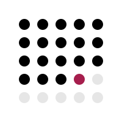
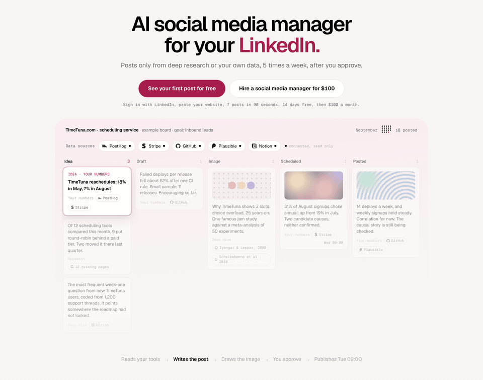
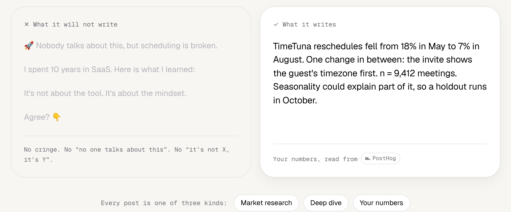
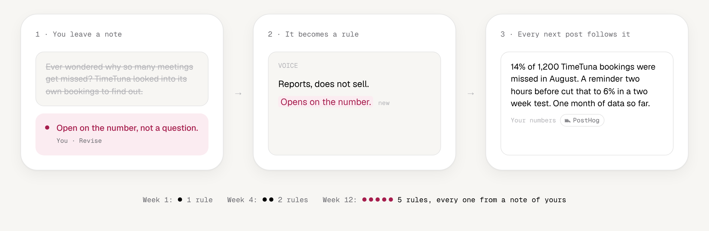

<p align="center">
  <a href="https://goodsocials.co">
    
  </a>
</p>

<h1 align="center">GoodSocials</h1>

<p align="center">
  <b>AI social media manager for LinkedIn.</b><br>
  Writes high quality content, you approve it in a kanban board, it schedules so you post regularly, close to daily.
</p>

<p align="center">
  <a href="https://goodsocials.co">goodsocials.co</a> ·
  <a href="#run-it-yourself">Run it yourself</a> ·
  <a href="#how-it-works">How it works</a> ·
  <a href="DECISIONS.md">Decisions</a> ·
  <a href="ROADMAP.md">Roadmap</a>
</p>

<p align="center">
  <a href="LICENSE"></a>
  
  
  
  
</p>

<p align="center">
  
</p>

---

## What it is

An approval queue for your LinkedIn feed. The agent writes, you approve, the
system publishes.

- **A board with five columns.** Idea, Draft, Image, Scheduled, Posted. Every
  card has three actions: Approve, Revise, Reject.
- **Posts from research and your own numbers.** Every post is market research,
  a deep dive, or a figure read from your own tools (Stripe, GitHub, PostHog,
  Plausible, Notion), with the source named on the card.
- **Corrections that stick.** A comment on one card rewrites that card and
  updates the profile's brand principles, so every later card follows it.
- **Cadence as the outcome.** Posts go out at 09:00 in your timezone, close to
  daily. The dashboard leads with posts published this month and your current
  streak, not followers.
- **Agency mode.** Run up to 12 LinkedIn profiles from one account, each with
  its own board, principles and connection.

The hosted version at [goodsocials.co](https://goodsocials.co) is 100 USD a
month per profile, or 1000 USD a month for up to 12 profiles. This repository
is the same code, MIT licensed.

## How it works

<p align="center">
  
</p>

1. **Sign in with LinkedIn and paste a URL.** The agent reads the site, writes
   three brand principles (voice, visual, format) and four themes, and fills
   the board with seven ideas.
2. **Ideas become drafts and images.** Text comes from Claude through the
   Anthropic API. Images come from FLUX.2 through OpenRouter, capped at 200 per
   profile per month so a runaway loop cannot spend money.
3. **A quality gate reads every post before it is scheduled.** Rules in code
   first, then an editor pass for invented numbers, unsupported claims and posts
   that say nothing. A held card stays in place and says what to fix.
4. **You approve.** The card moves to Scheduled. A cron on Vercel publishes it
   to `/rest/posts` at 09:00 in the board's timezone. LinkedIn has no scheduling
   endpoint, so the publish loop is ours.

<p align="center">
  
</p>

## The parts that took the longest to learn

The LinkedIn API has sharp edges, and they are all written down in
[`CLAUDE.md`](CLAUDE.md), verified against the live API. The short version:

- **Tokens last 60 days and there is no refresh token.** `offline_access` is not
  grantable on a standard app. GoodSocials emails on day 50, shows a banner on
  day 55, and pauses scheduling on day 60 instead of failing post by post.
- **A wrong scope fails silently.** LinkedIn shows its own error page and never
  calls your redirect URI. Scopes come from one constant, never a string at a
  call site.
- **150 calls per member per day.** Every call claims budget from a table
  before it goes out, so the limit is enforced, not reported.
- **There is no API for a member's post history.** The route that works is the
  archive the member downloads from LinkedIn settings; GoodSocials imports
  `Shares.csv` from it.
- **Images take three calls** (initialize, upload, reference) and each can fail
  on its own.

## Run it yourself

You need Node 20+, a Postgres database (Neon works out of the box), a LinkedIn
developer app with **Sign In with LinkedIn using OpenID Connect** and **Share on
LinkedIn** added, and an Anthropic API key.

```bash
git clone https://github.com/pavelk2/goodsocials.git
cd goodsocials
npm install
cp .env.example .env.local   # fill in the values
npm run db:push              # push the Drizzle schema to your database
npm run dev                  # http://localhost:3000
```

LinkedIn only accepts HTTPS redirect URLs, so local sign in needs a deployed
callback or an HTTPS tunnel. [`SETUP.md`](SETUP.md) walks through the LinkedIn
app, the database, and every environment variable. OpenRouter is needed for
images, Stripe for billing, Loops for email and PostHog for analytics.

The publish cron only posts for an account that may publish. Without Stripe,
mark your own account as paid by hand:

```bash
npx tsx scripts/set-plan.ts you@example.com pro --paid
```

To publish one post from the command line:

```bash
npx tsx scripts/linkedin-post.ts "text of the post"
```

### Deploy

The repo is built for Vercel: app, API routes and both crons in one project.
`vercel.json` runs the publish loop every 15 minutes and the source sync daily
at 04:00 UTC. Set `CRON_SECRET` and Vercel sends it as a bearer token.

## Stack

| Layer | Choice |
|---|---|
| App | Next.js 16 App Router, React 19, TypeScript strict |
| Data | Neon Postgres, Drizzle ORM, migrations as files |
| Auth | Auth.js with LinkedIn OIDC, tokens encrypted with AES-256-GCM |
| Board | Tailwind, dnd-kit for keyboard-accessible drag |
| Text | Claude via the Anthropic API, structured output |
| Images | FLUX.2 Pro via OpenRouter, held in Vercel Blob until upload |
| Billing | Stripe Checkout and the Stripe billing portal |
| Email and analytics | Loops, PostHog |
| Scheduling | Vercel Cron |

## Repository layout

```
app/              routes: marketing pages, board, settings, api (auth, cron, webhooks)
components/board/ the only place card markup lives
lib/              domain logic, no React
lib/linkedin/     every call to LinkedIn, nothing else talks to their API
lib/agent/        prompts, ideas, drafts, revisions, review, images
lib/integrations/ the five read-only sources and their adapters
db/               Drizzle schema and migrations
scripts/          operator scripts: logo and share-card export, set-plan, test post
```

## Docs

- [`CLAUDE.md`](CLAUDE.md): start here. The product, the data model, and the
  verified LinkedIn constraints. Written for humans and coding agents alike.
- [`DECISIONS.md`](DECISIONS.md): what is settled and why.
- [`ROADMAP.md`](ROADMAP.md): what is next, ordered by risk.
- [`DESIGN.md`](DESIGN.md): the accent, the streak-grid mark, the board.
- [`SETUP.md`](SETUP.md): the steps that need a logged-in browser.

## Contributing

Issues and pull requests are welcome. Before opening one:

```bash
npm run typecheck
npm run lint
```

One branch per change with a descriptive slug, and the reason for any new
dependency in the commit message. Copy a user reads follows the writing rules
at the end of [`CLAUDE.md`](CLAUDE.md): sentence case, no em dashes, no
buzzwords, and generated posts in the third person.

## License

[MIT](LICENSE). The Geist font in `assets/fonts` ships under its own
[SIL Open Font License](assets/fonts/Geist-LICENSE.txt).

Built by [Pavel](https://github.com/pavelk2) in Amsterdam.
